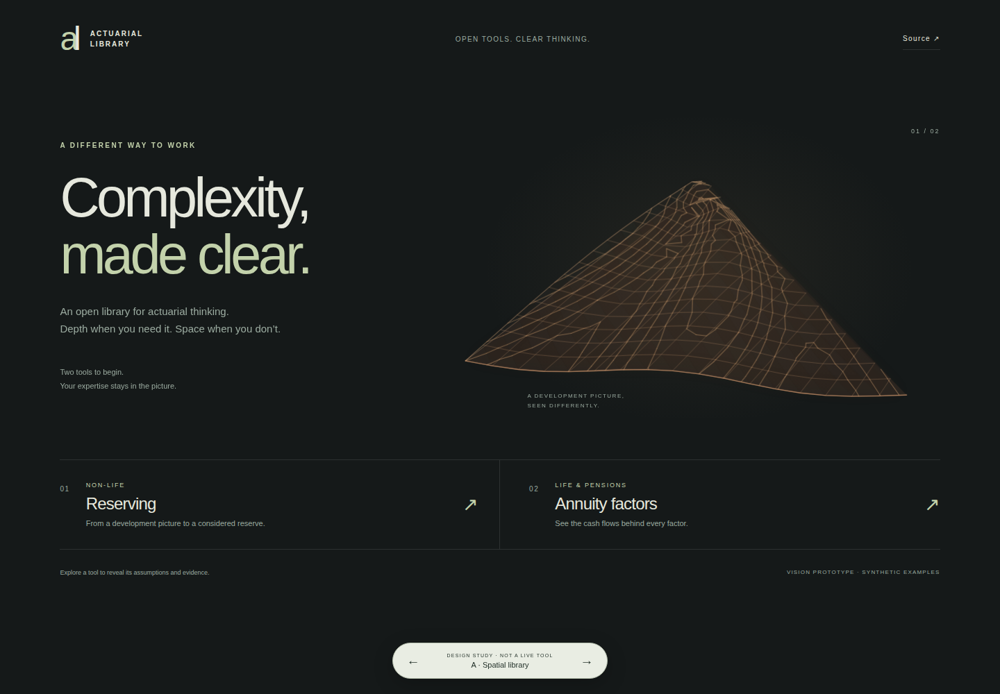
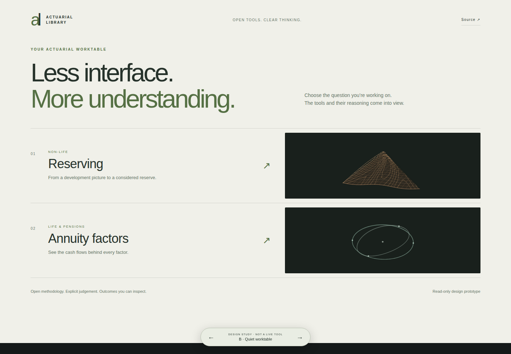
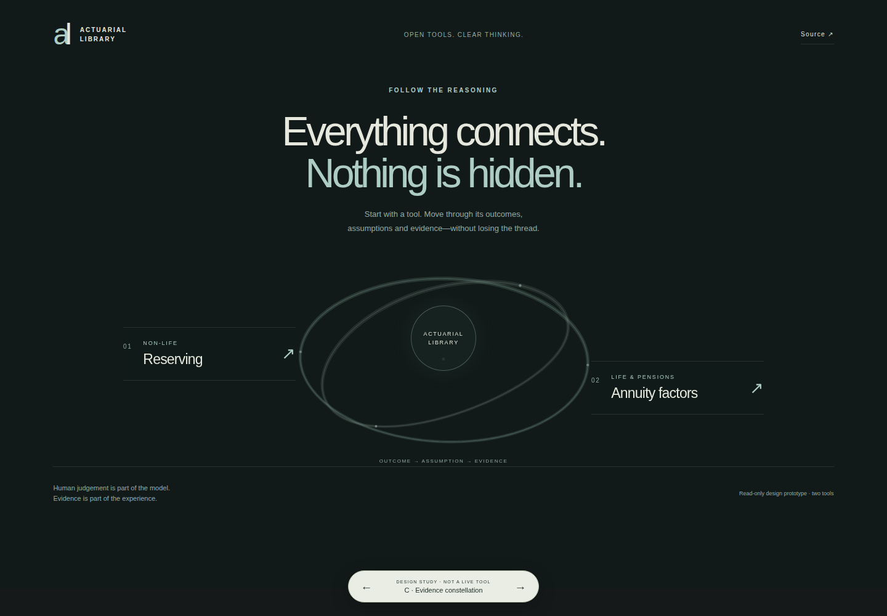
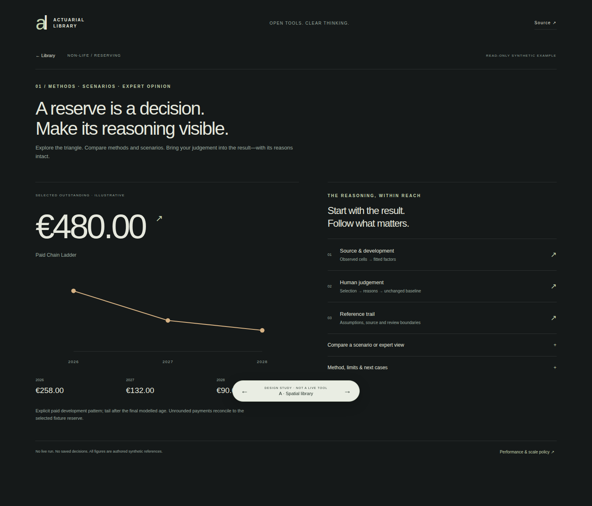
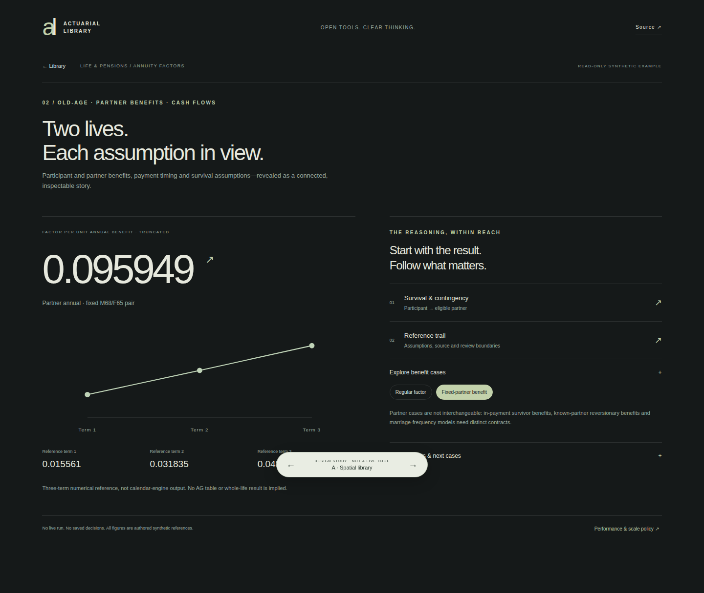
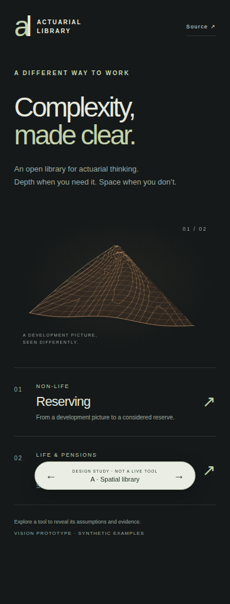

# Actuarial Library — visual decision prototype

Question: can a calm, spatial two-tool library reveal professional depth without a button-heavy dashboard?

Three deliberately different structures share one read-only prototype:

- **A · Spatial library:** sculptural development picture, two quiet tool entrances. Lead recommendation for the founder's video-inspired direction.
- **B · Quiet worktable:** light editorial rows; the tools, not a hero object, organize the page.
- **C · Evidence constellation:** two destinations around a shared evidence hub.

Use the bottom arrows or left/right keys to compare. Click Reserving or Annuity factors; click the result or evidence rows for detail. Scenario and benefit choices only switch authored fixtures in memory.

## Run locally

From the repository root, with Python 3:

```sh
python3 scripts/run_vision_prototype.py
```

Open `http://127.0.0.1:8766/index.html?variant=A`; replace A with B or C. The runner serves only this prototype directory, on loopback. It does not start the real workspace or access its database.

## GitHub visual previews

The branch workflow renders public synthetic desktop and mobile screenshots. These are previews, not a hosted interactive application.








## Evidence and limits

Reserving fixtures: paid Chain Ladder 480; BF alternative 460; expert judgement 470. Their displayed payment schedules reconcile to those authored totals. Baseline remains unchanged when a reference scenario is selected.

Annuity fixtures are three numerical reference terms, not calendar-engine output: regular annual 50/50 factor-space mix 2.825921; independent fixed M68/F65 partner contingency 0.095949. Both use synthetic mortality and flat annual-effective 2% discount. They are truncated, not AG or whole-life calculations. Source assumptions and residual survival appear in the drill-down.

Original projected geometry uses canvas with no external runtime dependency. Motion pauses offscreen/when hidden, is capped at 15 fps, and is static on small screens and with reduced-motion preference.

Founder acceptance, live evidence integration, actual portfolio benchmarks, expanded marriage models and production release remain pending. See [scope reconciliation](../../docs/project/VISION_SCOPE_RECONCILIATION.md).

This is a design prototype, not an approved calculation engine, formal audit system or production release. No private data or existing local changes are copied into this checkout.
